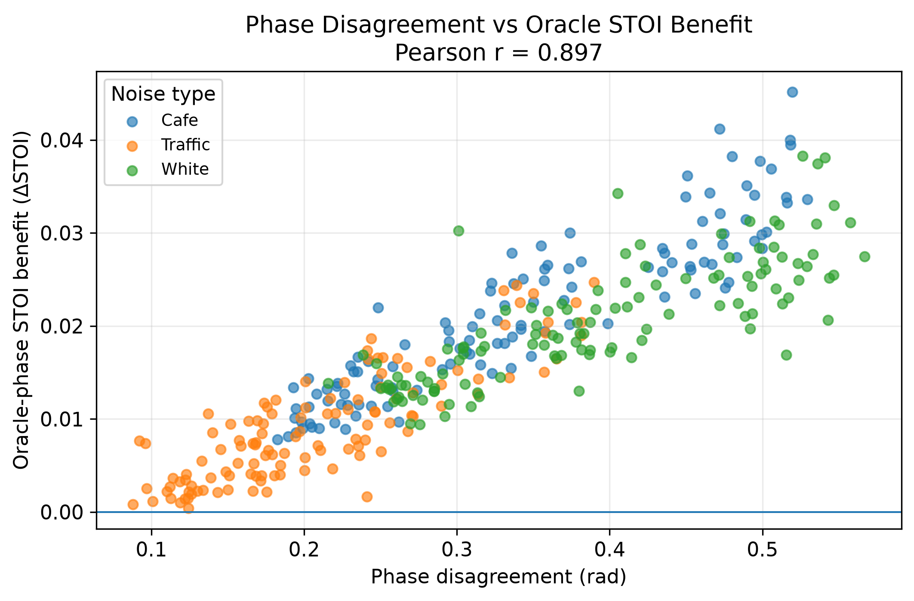
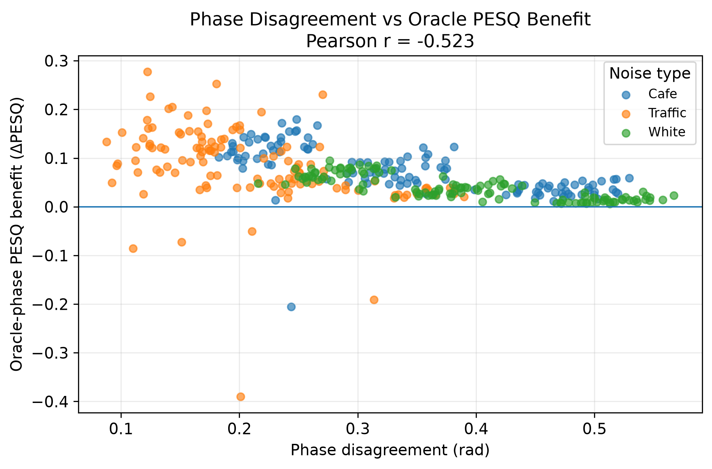
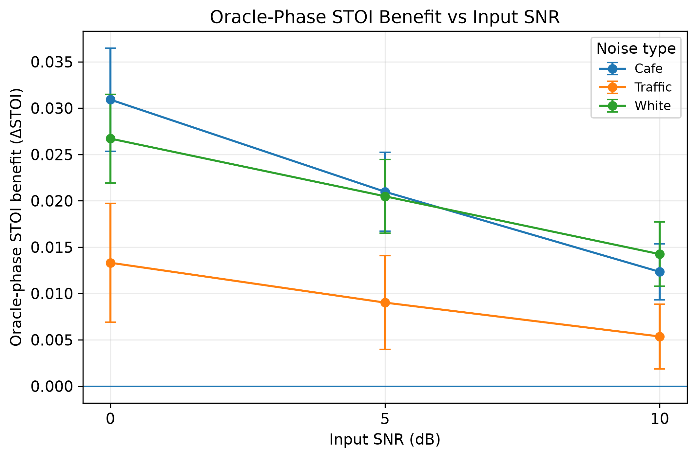
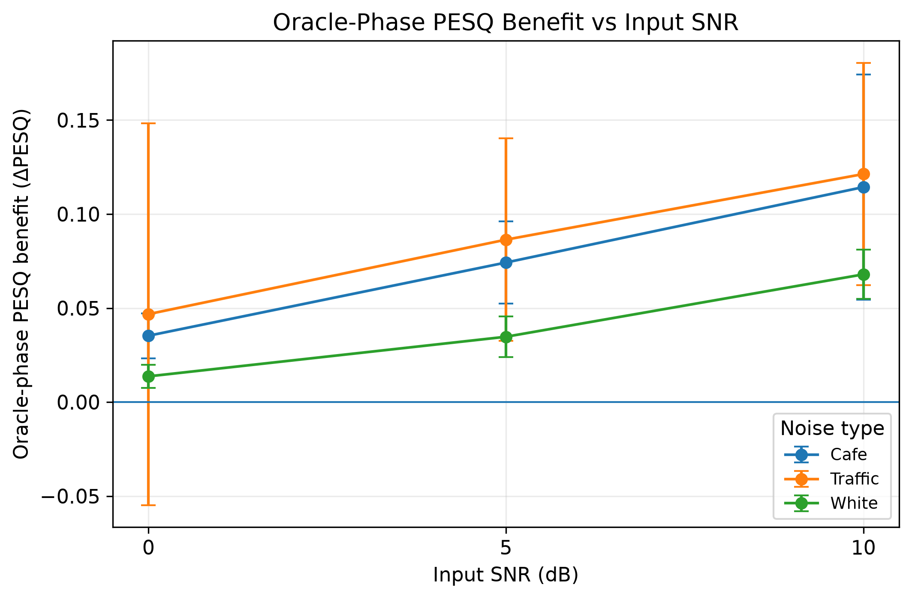
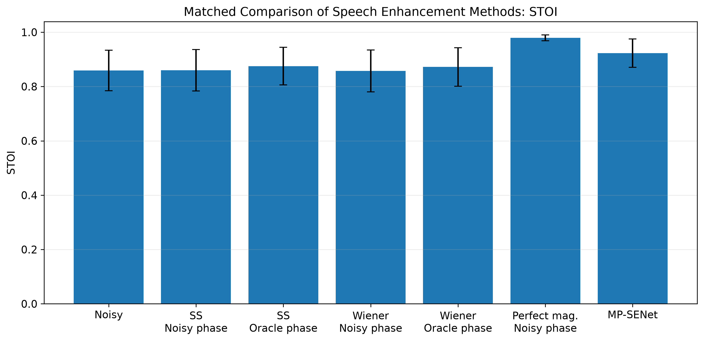
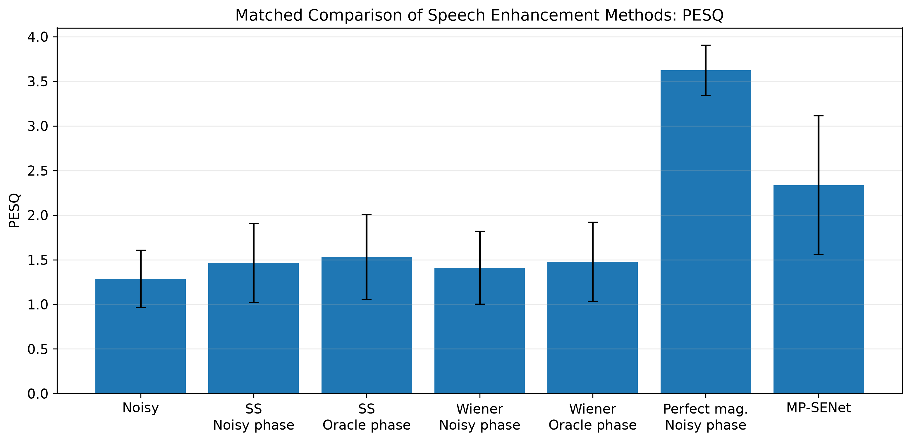
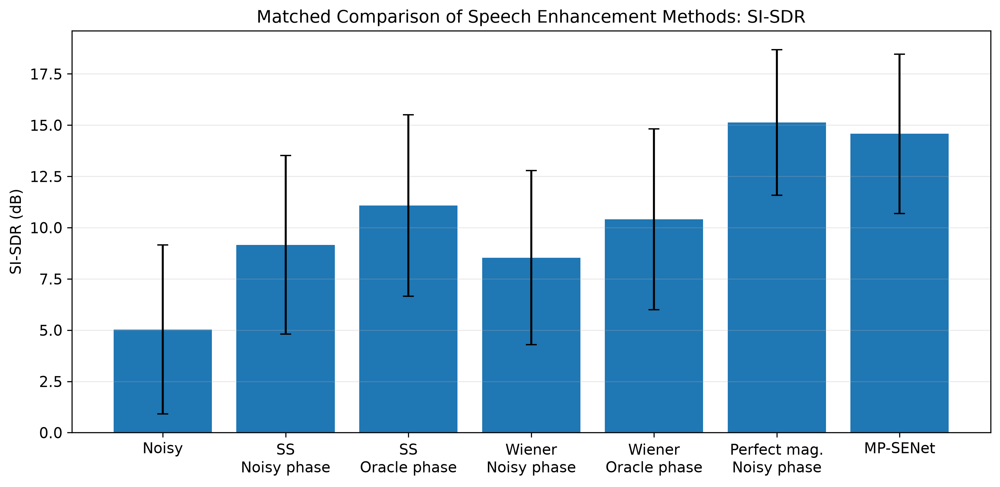
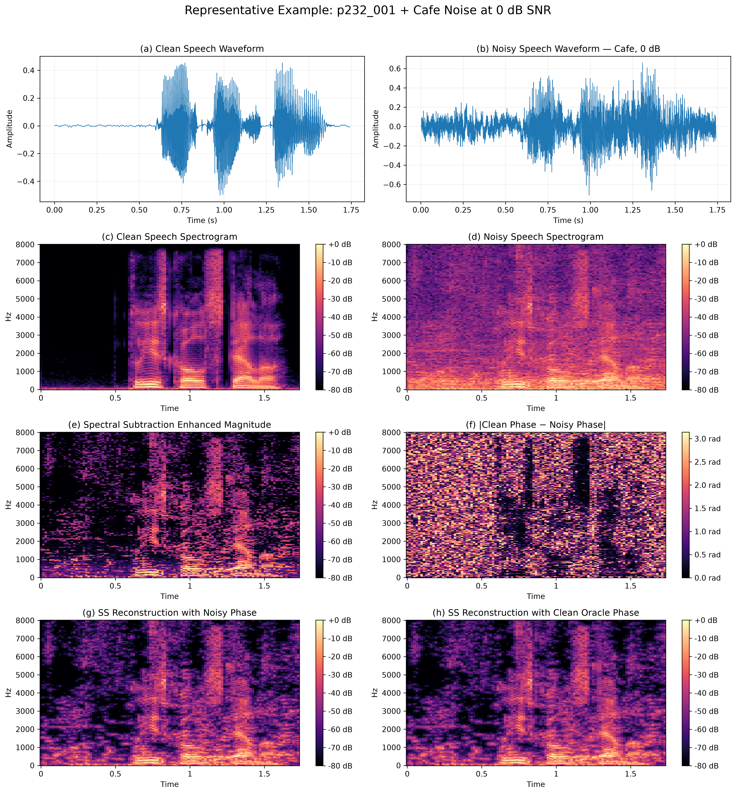

# Investigating Phase Limitations in STFT-Based Speech Enhancement Using Oracle-Phase Analysis

## 1. Student Information

- **Name:** Suxin Liu
- **Student ID:** 540569223
- **GitHub Username:** sliu2040977-hash
- **Course:** ELEC5305
- **GitHub Repository:** https://github.com/sliu2040977-hash/elec5305-project-540569223

---

## 2. Project Overview

Single-channel speech enhancement aims to recover intelligible and high-quality speech from recordings corrupted by environmental noise. Many classical short-time Fourier transform (STFT) based enhancement methods estimate an improved magnitude spectrum but reconstruct the enhanced signal using the original phase of the noisy mixture.

This project investigates when this noisy-phase assumption becomes a limitation in classical speech enhancement.

Spectral subtraction and Wiener filtering are used as classical STFT-based baselines. Rather than treating their direct performance comparison as the main research question, the project separates the effects of magnitude estimation and phase information.

For each classical enhancement method, two reconstructions are evaluated:

1. estimated enhanced magnitude + original noisy phase;
2. the same estimated enhanced magnitude + oracle clean-speech phase.

Because the magnitude estimate remains unchanged between these two conditions, the performance difference provides a controlled measurement of the effect of phase information.

A further diagnostic condition uses the **perfect clean magnitude with noisy phase**. This tests whether noisy phase still limits performance even when magnitude estimation is ideal.

Finally, a pretrained **MP-SENet** model is evaluated as a modern phase-aware speech enhancement reference. MP-SENet explicitly estimates magnitude and phase spectra in parallel, allowing the classical noisy-phase assumption to be compared with a modern joint magnitude-and-phase approach.

### Research Question

> **For classical STFT speech enhancement, when is reuse of noisy phase a limiting assumption, how large is the achievable improvement if phase is known accurately, and does a modern phase-aware pretrained enhancer reduce that gap?**

---

## 3. Background and Motivation

Traditional frequency-domain speech enhancement commonly operates using an analysis-modification-synthesis framework. A noisy signal is transformed into the time-frequency domain using the STFT, its spectral magnitude is modified, and the signal is reconstructed using the inverse STFT.

Classical algorithms such as **spectral subtraction** and **Wiener filtering** mainly focus on estimating or modifying spectral magnitude. These methods are computationally simple and provide useful reference baselines, but the phase of the noisy mixture is commonly reused during reconstruction.

Research has shown that phase should not always be treated as unimportant. Paliwal, Wójcicki and Shannon investigated the importance of phase in speech enhancement and demonstrated that phase modification can affect the quality of reconstructed speech. This motivates the central experiment in this project: holding the enhanced magnitude constant while replacing noisy phase with clean oracle phase.

Later speech enhancement research increasingly moved from magnitude-only processing toward complex-domain and phase-aware modelling. Complex spectral estimation and complex ratio masking allow models to modify both real and imaginary components of a time-frequency representation rather than treating phase as fixed.

DCCRN represents an important stage in this development. It applies complex-valued convolutional and recurrent processing to phase-aware speech enhancement and demonstrated strong performance in the 2020 Deep Noise Suppression Challenge. DCCRN is therefore used in this project as an important literature reference rather than as an additional implemented model.

More recently, MP-SENet explicitly estimates magnitude and wrapped phase spectra in parallel. A pretrained VoiceBank+DEMAND checkpoint is used in this project as the modern phase-aware comparison. No neural network is trained as part of this project.

The progression motivating the project is therefore:

**classical magnitude-based enhancement → recognition of phase importance → complex/phase-aware enhancement → explicit joint magnitude-and-phase neural enhancement**

---

## 4. Methodology

### 4.1 Tools

The project is implemented in Python using:

- NumPy
- SciPy
- librosa
- SoundFile
- Matplotlib
- pandas
- pystoi
- pesq
- PyTorch
- pretrained MP-SENet

All experimental code and result-generation scripts are contained in this repository.

### 4.2 Dataset

Speech material is taken from the **VoiceBank** speech corpus, while environmental noise is based on **DEMAND** recordings.

The controlled experiment uses:

- 40 clean speech utterances;
- two VoiceBank speakers (`p232` and `p257`);
- three noise conditions:
  - Cafe
  - Traffic
  - White noise
- three input SNR levels:
  - 0 dB
  - 5 dB
  - 10 dB

This produces:

**40 utterances × 3 noise types × 3 SNR levels = 360 controlled noisy mixtures.**

Cafe and traffic recordings are obtained from DEMAND. White noise is generated using a fixed random seed for reproducibility.

Using controlled mixtures allows the input SNR and noise condition to be varied systematically.

### 4.3 STFT Processing

All signals are processed at 16 kHz.

The main STFT parameters are:

- FFT size: 512
- Window length: 512 samples
- Hop length: 256 samples
- Window: Hann

For a noisy STFT signal,

`Y(k,n) = |Y(k,n)| exp(jφY(k,n))`

the magnitude and phase components are separated explicitly.

This makes it possible to reconstruct the same enhanced magnitude using either noisy phase or clean oracle phase.

### 4.4 Classical Enhancement

Two classical enhancement algorithms are implemented.

#### Spectral Subtraction

Spectral subtraction estimates the noise magnitude spectrum and subtracts it from the noisy magnitude spectrum. A spectral floor is used to prevent negative or excessively small spectral magnitudes.

#### Wiener Filtering

Wiener filtering estimates a time-frequency gain based on speech and noise power and applies the gain to the noisy magnitude spectrum.

These methods are used as controlled experimental baselines rather than as the primary comparison of the project.

### 4.5 Oracle-Phase Experiment

For each classical method, two versions are reconstructed:

- **Noisy-phase reconstruction**
- **Clean oracle-phase reconstruction**

For example,

`SS magnitude + noisy phase`

is compared with:

`same SS magnitude + clean phase`

and similarly for Wiener filtering.

Because the magnitude is identical within each pair, any metric difference is attributable to the phase used for reconstruction.

The clean-phase condition is an **oracle diagnostic** and is not a deployable enhancement system.

### 4.6 Perfect-Magnitude Diagnostic

An additional diagnostic reconstruction uses:

**clean magnitude + noisy phase**

This represents a perfect magnitude estimate while deliberately retaining the noisy phase.

It provides an important reference for determining whether phase remains the dominant limitation once magnitude-estimation error is removed.

### 4.7 Phase Disagreement

The project also measures disagreement between clean and noisy phase.

Wrapped phase difference is computed in the STFT domain and summarized as a phase-disagreement measure.

This is compared with the improvement produced by replacing noisy phase with clean oracle phase.

The objective is to test whether larger phase disagreement predicts a larger potential benefit from accurate phase information.

### 4.8 Objective Metrics

Three objective metrics are used:

- **STOI** — speech intelligibility
- **PESQ** — perceptual speech quality
- **SI-SDR** — signal reconstruction/distortion performance

STOI is calculated using `pystoi`. PESQ is evaluated in wideband mode for the 16 kHz signals.

Using multiple metrics is important because phase information does not necessarily affect intelligibility, perceptual quality and signal distortion in the same way.

### 4.9 MP-SENet

After completing the oracle-phase experiment, a pretrained **MP-SENet** VoiceBank+DEMAND checkpoint is used as a modern phase-aware reference.

MP-SENet estimates magnitude and phase spectra jointly rather than reusing noisy phase.

No training or parameter tuning is performed in this project.

Due to computational/runtime limits in the available GitHub Codespaces environment, MP-SENet inference was successfully completed for **167 of the 360 controlled mixtures**.

To avoid an unfair comparison, MP-SENet is not compared with classical averages computed from all 360 mixtures. Instead, all classical and oracle methods are re-selected on exactly the **same 167 mixtures**, producing a strict matched comparison with `N = 167` for every method.

The completed MP-SENet subset includes both speakers. It contains 18 unique utterances from `p232` and 9 from `p257`. Its noise distribution is Cafe = 57, Traffic = 59 and White = 51 mixtures, while its SNR distribution is 0 dB = 56, 5 dB = 54 and 10 dB = 57 mixtures.

The subset is therefore reasonably distributed across the experimental noise and SNR conditions, although it was not constructed as a formally randomized subset.

---

## 5. Current Results

### 5.1 Full Oracle-Phase Experiment

The complete classical experiment contains:

- 40 clean utterances
- 3 noise types
- 3 SNR levels
- 360 noisy mixtures
- 6 classical/diagnostic conditions per mixture

This produces **2160 metric rows**.

The experiment confirms that replacing noisy phase with clean oracle phase produces measurable improvements while keeping the magnitude estimate unchanged.

The final result figures are available in:

`results/final_figures/`

### 5.2 Phase Disagreement

Across the 360-mixture experiment, the relationship between phase disagreement and oracle-phase benefit is strongly dependent on the evaluation metric.

The measured Pearson correlations are:

| Metric improvement | Correlation with phase disagreement |
|---|---:|
| ΔSTOI | **+0.8969** |
| ΔPESQ | **−0.5234** |
| ΔSI-SDR | **+0.0855** |

The strong positive relationship for STOI indicates that larger phase disagreement is associated with a larger intelligibility benefit from oracle phase.

However, the same relationship does not generalize across all metrics. PESQ shows a moderate negative correlation, while SI-SDR shows almost no linear correlation.

Therefore, phase disagreement cannot be treated as a universal predictor of enhancement improvement. Its relationship with oracle-phase benefit depends strongly on the evaluation criterion.

### 5.3 Oracle-Phase Benefit Across SNR

The oracle-phase benefit is also evaluated separately at 0, 5 and 10 dB and across Cafe, Traffic and White noise.

These experiments show that the effect of phase cannot be summarized by a single global number. The benefit depends on the noise condition, SNR and objective metric.

---

## 6. Matched MP-SENet Comparison

For a fair comparison with MP-SENet, all enhancement methods below are evaluated on exactly the same **167 mixtures**.

| Method | Phase used | STOI | PESQ | SI-SDR (dB) |
|---|---|---:|---:|---:|
| Noisy | Noisy | 0.8595 | 1.2844 | 5.03 |
| Spectral Subtraction | Noisy | 0.8597 | 1.4639 | 9.16 |
| Spectral Subtraction | Clean oracle | 0.8749 | 1.5312 | 11.09 |
| Wiener Filtering | Noisy | 0.8573 | 1.4098 | 8.53 |
| Wiener Filtering | Clean oracle | 0.8720 | 1.4765 | 10.40 |
| Perfect magnitude | Noisy | **0.9794** | **3.6227** | **15.13** |
| MP-SENet | Estimated phase | **0.9231** | **2.3356** | **14.58** |
| Clean speech | Clean | **1.0000 (reference)** | **Reference** | **∞ / perfect reference** |

The clean-speech condition is included as a reference rather than as an enhancement method. STOI is 1 for an identical clean reference and target. PESQ and SI-SDR are not reported as ordinary experimental scores for this row because the signal is being compared with itself; in particular, the ideal SI-SDR is unbounded. This reference is therefore not included in the statistical comparison plots.

### 6.1 Effect of Oracle Phase

For spectral subtraction, replacing noisy phase with clean phase changes:

- STOI: 0.8597 → 0.8749
- PESQ: 1.4639 → 1.5312
- SI-SDR: 9.16 → 11.09 dB

For Wiener filtering:

- STOI: 0.8573 → 0.8720
- PESQ: 1.4098 → 1.4765
- SI-SDR: 8.53 → 10.40 dB

Therefore, noisy-phase reuse is a measurable limitation of both classical methods.

### 6.2 Perfect-Magnitude Result

The perfect-magnitude condition achieves:

- STOI = **0.9794**
- PESQ = **3.6227**
- SI-SDR = **15.13 dB**

Despite retaining noisy phase, it achieves the strongest overall objective performance among the evaluated non-clean-reference conditions.

This is an important result because it shows that the experiments do **not** support the simple conclusion that phase is always the dominant bottleneck.

Magnitude-estimation accuracy remains highly important.

### 6.3 MP-SENet Result

MP-SENet achieves:

- STOI = **0.9231**
- PESQ = **2.3356**
- SI-SDR = **14.58 dB**

It substantially outperforms the noisy signal, spectral subtraction and Wiener filtering, including their clean-phase oracle versions on this matched subset.

However, it remains below the perfect-magnitude diagnostic condition.

This suggests that modern phase-aware enhancement benefits from joint magnitude-and-phase modelling rather than phase correction alone.

---

## 7. Representative Acoustic Analysis

A representative example was selected to examine the effect of phase reconstruction at the individual-utterance level:

- **Clean utterance:** `p232_001.wav`
- **Noise:** Cafe
- **Input SNR:** 0 dB

The figure below shows the clean and noisy waveforms, clean and noisy spectrograms, the spectral-subtraction enhanced magnitude, clean/noisy phase disagreement, and reconstructions using noisy and clean oracle phase.

The objective results for this individual example are:

| Method | STOI | PESQ | SI-SDR (dB) |
|---|---:|---:|---:|
| Noisy | 0.7433 | 1.1941 | -0.13 |
| SS + noisy phase | 0.7277 | 1.2226 | 2.23 |
| SS + clean oracle phase | **0.7512** | **1.2703** | **4.75** |
| Wiener + noisy phase | 0.7273 | 1.1957 | 2.15 |
| Wiener + clean oracle phase | **0.7481** | **1.2421** | **4.60** |
| MP-SENet | **0.8403** | **1.9166** | **11.03** |

For both classical methods, replacing noisy phase with clean oracle phase improves STOI, PESQ and SI-SDR while leaving the estimated magnitude unchanged. This provides a clear utterance-level example of the limitation introduced by noisy-phase reuse.

MP-SENet produces substantially higher objective scores than either classical reconstruction for this example, consistent with the broader matched-subset results.

### Listening Samples

The corresponding audio examples are provided in:

`results/representative_example/audio/`

Available files are:

- `clean.wav`
- `noisy.wav`
- `ss_noisy_phase.wav`
- `ss_oracle_phase.wav`
- `wiener_noisy_phase.wav`
- `wiener_oracle_phase.wav`
- `mpsenet.wav`

These samples allow direct listening comparison between the original noisy signal, classical noisy-phase reconstruction, oracle-phase reconstruction and the pretrained phase-aware model.

Because no formal subjective listening test was conducted, qualitative claims about perceived musical noise, roughness, phasiness or residual noise are not used as quantitative conclusions. The audio files are provided for informal inspection alongside the objective measurements.

---

## 8. Main Findings

The experiments support four main findings.

### Finding 1 — Noisy Phase Is a Measurable Limitation

When the estimated magnitude is held constant, replacing noisy phase with clean oracle phase improves spectral subtraction and Wiener filtering.

Therefore, noisy-phase reuse imposes a measurable limitation on classical STFT enhancement.

### Finding 2 — The Importance of Phase Is Metric-Dependent

Phase disagreement strongly predicts oracle-phase STOI improvement (`r = 0.8969`), but does not predict PESQ and SI-SDR improvement in the same way.

Phase limitations should therefore not be described using only one objective metric.

### Finding 3 — Magnitude Estimation Remains Extremely Important

The perfect-magnitude + noisy-phase condition produces the strongest objective performance among the non-clean-reference conditions.

This demonstrates that magnitude-estimation error remains a major source of performance loss even when phase is imperfect.

### Finding 4 — Modern Phase-Aware Enhancement Is More Than Phase Replacement

MP-SENet substantially outperforms the classical enhancement methods, including their oracle-phase versions on the matched subset.

Its advantage therefore cannot be explained simply by replacing noisy phase with a better phase estimate. Joint magnitude-and-phase modelling provides a more powerful enhancement strategy.

---

## 9. Limitations

Several limitations should be considered when interpreting the results.

First, the controlled experiment contains 40 utterances from two VoiceBank speakers rather than a larger multi-speaker dataset.

Second, the oracle clean phase is available only because the clean reference signal is known. It is a diagnostic experiment and is not available in a real deployment scenario.

Third, the classical experiment uses controlled noise mixtures where the added noise signal is known. This provides experimental control but differs from practical blind noise estimation.

Fourth, MP-SENet inference was completed for 167 of 360 mixtures because of CPU/runtime constraints in GitHub Codespaces. Therefore, MP-SENet comparisons are reported only on the same matched 167-mixture subset.

The completed subset contains both speakers and remains approximately balanced across the three noise types and three SNR levels, although it was not constructed as a formally randomized subset.

Finally, the pretrained MP-SENet model was not retrained or adapted to the controlled experimental mixtures. Its results therefore represent pretrained-model inference rather than dataset-specific optimisation.

---

## 10. Project Progress

The following components have been completed:

- [x] Literature review and revised research question
- [x] VoiceBank speech preparation
- [x] DEMAND noise preparation
- [x] Controlled SNR mixing
- [x] STFT/ISTFT implementation
- [x] Spectral subtraction
- [x] Wiener filtering
- [x] Noisy-phase reconstruction
- [x] Clean oracle-phase reconstruction
- [x] Perfect-magnitude diagnostic
- [x] Phase-disagreement measurement
- [x] STOI evaluation
- [x] PESQ evaluation
- [x] SI-SDR evaluation
- [x] Preliminary single-utterance experiment
- [x] Full 360-mixture classical experiment
- [x] Oracle-phase benefit analysis
- [x] Phase-disagreement correlation analysis
- [x] Pretrained MP-SENet inference
- [x] 167-mixture matched MP-SENet comparison
- [x] Representative acoustic analysis
- [x] Listening samples
- [x] Final result figures

No neural network training is required for the current project scope.

---

## 11. Repository Structure

    elec5305-project-540569223/
    │
    ├── src/
    │   ├── audio_utils.py
    │   ├── mixing.py
    │   ├── stft_utils.py
    │   ├── spectral_subtraction.py
    │   ├── wiener_filter.py
    │   ├── phase_reconstruction.py
    │   └── metrics.py
    │
    ├── experiments/
    │   ├── preliminary_experiment.py
    │   ├── full_experiment.py
    │   ├── summarize_full_results.py
    │   ├── plot_full_results.py
    │   ├── generate_mpsenet_inputs.py
    │   ├── prepare_mpsenet_batch.py
    │   ├── run_mpsenet_batches.py
    │   ├── evaluate_mpsenet.py
    │   ├── compare_matched_results.py
    │   ├── plot_final_results.py
    │   └── generate_representative_example.py
    │
    ├── results/
    │   ├── preliminary/
    │   ├── full_experiment/
    │   ├── matched_comparison/
    │   ├── mpsenet/
    │   ├── final_figures/
    │   └── representative_example/
    │       ├── representative_analysis.png
    │       ├── metrics.csv
    │       └── audio/
    │
    ├── data/
    │   └── README.md
    │
    ├── requirements.txt
    └── README.md

Large source datasets, pretrained model files and bulk generated WAV files are not stored directly in this repository.

---

## 12. Reproduction

Install the required Python packages:

    pip install -r requirements.txt

Run the preliminary experiment:

    PYTHONPATH=.:./src python experiments/preliminary_experiment.py

Run the full classical/oracle experiment:

    PYTHONPATH=.:./src python experiments/full_experiment.py

Generate full-experiment summaries:

    python experiments/summarize_full_results.py

Generate the full classical figures:

    python experiments/plot_full_results.py

After MP-SENet inference and evaluation, create the matched comparison:

    python experiments/compare_matched_results.py

Generate the final report figures:

    python experiments/plot_final_results.py

Generate the representative acoustic analysis:

    PYTHONPATH=.:./src python experiments/generate_representative_example.py

The generated numerical results are stored as CSV files under `results/`, while final figures are stored under `results/final_figures/` and `results/representative_example/`.

---

## 13. Expected / Current Outcomes

The project delivers:

1. a reproducible STFT speech-enhancement experiment;
2. implementations of spectral subtraction and Wiener filtering;
3. controlled noisy-phase versus clean-phase reconstruction;
4. quantitative measurement of oracle-phase benefit;
5. phase-disagreement analysis;
6. STOI, PESQ and SI-SDR evaluation;
7. a perfect-magnitude diagnostic experiment;
8. comparison with a pretrained modern phase-aware model;
9. representative acoustic and listening analysis;
10. figures and CSV results suitable for further analysis and reporting.

The central conclusion from the current experiments is:

> **Reusing noisy phase is a measurable limitation of classical STFT-based speech enhancement, but the importance of this limitation depends strongly on the evaluation metric and interacts with magnitude-estimation accuracy. Modern joint magnitude-and-phase enhancement provides substantial improvement over classical methods, while the perfect-magnitude experiment shows that magnitude estimation remains a major limiting factor.**

---

## 14. References

The references below follow the progression from classical magnitude-based enhancement, through research on phase importance and complex-domain processing, to modern phase-aware neural speech enhancement and the datasets and metrics used for evaluation.

[1] S. F. Boll, “Suppression of acoustic noise in speech using spectral subtraction,” *IEEE Transactions on Acoustics, Speech, and Signal Processing*, vol. 27, no. 2, pp. 113–120, 1979.

[2] P. C. Loizou, *Speech Enhancement: Theory and Practice*, 2nd ed. Boca Raton, FL, USA: CRC Press, 2013.

[3] K. K. Paliwal, K. K. Wójcicki, and B. J. Shannon, “The importance of phase in speech enhancement,” *Speech Communication*, vol. 53, no. 4, pp. 465–494, 2011, doi: 10.1016/j.specom.2010.12.003.

[4] D. S. Williamson, Y. Wang, and D. Wang, “Complex ratio masking for monaural speech separation,” *IEEE/ACM Transactions on Audio, Speech, and Language Processing*, vol. 24, no. 3, pp. 483–492, 2016.

[5] Y. Hu, Y. Liu, S. Lv, M. Xing, S. Zhang, Y. Fu, J. Wu, B. Zhang, and L. Xie, “DCCRN: Deep Complex Convolution Recurrent Network for Phase-Aware Speech Enhancement,” in *Proceedings of Interspeech*, 2020.

[6] Y.-X. Lu, Y. Ai, and Z.-H. Ling, “MP-SENet: A Speech Enhancement Model with Parallel Denoising of Magnitude and Phase Spectra,” in *Proceedings of Interspeech*, pp. 3834–3838, 2023.

[7] C. Valentini-Botinhao, X. Wang, S. Takaki, and J. Yamagishi, “Investigating RNN-based speech enhancement methods for noise-robust text-to-speech,” in *Proceedings of SSW*, 2016.

[8] J. Thiemann, N. Ito, and E. Vincent, “The Diverse Environments Multi-channel Acoustic Noise Database (DEMAND): A database of multichannel environmental noise recordings,” in *Proceedings of Meetings on Acoustics*, vol. 19, 2013.

[9] C. H. Taal, R. C. Hendriks, R. Heusdens, and J. Jensen, “An algorithm for intelligibility prediction of time-frequency weighted noisy speech,” *IEEE Transactions on Audio, Speech, and Language Processing*, vol. 19, no. 7, pp. 2125–2136, 2011.

[10] A. W. Rix, J. G. Beerends, M. P. Hollier, and A. P. Hekstra, “Perceptual evaluation of speech quality (PESQ)—A new method for speech quality assessment of telephone networks and codecs,” in *Proceedings of IEEE ICASSP*, 2001.

---

## 15. Resources

The following public datasets, implementations and research resources were used or consulted in this project.

- **VoiceBank + DEMAND Dataset**  
  University of Edinburgh DataShare:  
  https://datashare.ed.ac.uk/handle/10283/1942

- **DEMAND: Diverse Environments Multichannel Acoustic Noise Database**  
  Zenodo:  
  https://zenodo.org/records/1227121

- **MP-SENet — Official Implementation**  
  Ye-Xin Lu, Yang Ai and Zhen-Hua Ling:  
  https://github.com/yxlu-0102/MP-SENet

- **DCCRN / DeepComplexCRN — Official Implementation**  
  Yanxin Hu et al.:  
  https://github.com/huyanxin/DeepComplexCRN

- **pystoi — Python Implementation of STOI**  
  https://github.com/mpariente/pystoi

- **PESQ — Python Wrapper**  
  https://github.com/ludlows/PESQ

- **Paliwal, Wójcicki and Shannon — “The Importance of Phase in Speech Enhancement”**  
  *Speech Communication*, vol. 53, no. 4, pp. 465–494, 2011.  
  DOI: https://doi.org/10.1016/j.specom.2010.12.003
