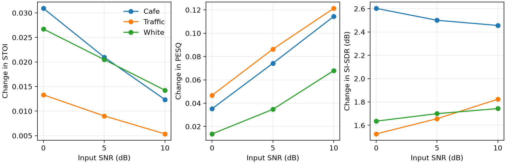
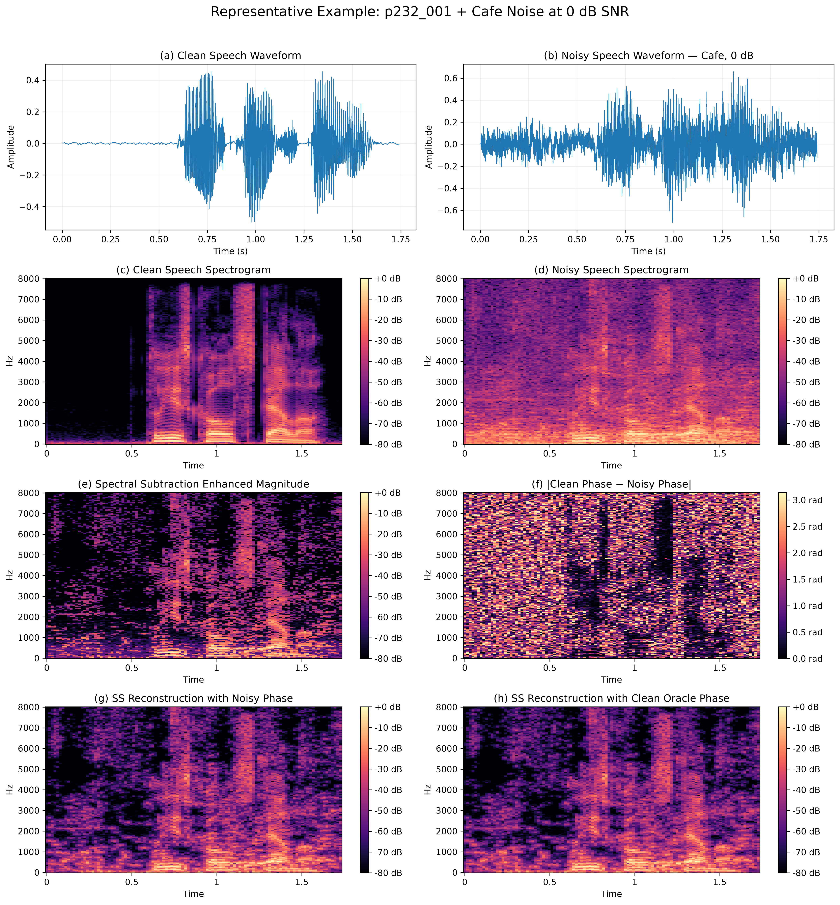

# Phase limitations in STFT speech enhancement

**Suxin Liu · ELEC5305 · SID 540569223**

How much does reusing noisy phase limit classical speech enhancement when the estimated magnitude is held fixed?

[Final project report (PDF)](ELEC5305_Final_Report.pdf) · [Demonstration video (MP4)](ELEC5305_Demo.mp4) · [Repository and reproduction instructions](https://github.com/sliu2040977-hash/elec5305-project-540569223) · [Download source ZIP](https://github.com/sliu2040977-hash/elec5305-project-540569223/archive/refs/heads/main.zip)

**Project milestones** · [01 Project proposal (PDF)](ELEC5305_01_Project_Proposal.pdf) · [02 Progress description (PDF)](ELEC5305_02_Project_Progress.pdf)

## Results

Across 360 mixtures, supplying clean phase to the same spectral-subtraction magnitude added 0.0170 STOI, 0.0661 PESQ and 1.96 dB SI-SDR on average. STOI improved on every pair in this archive. PESQ and SI-SDR had occasional decreases.

For spectral subtraction, the pooled correlation between phase disagreement and PESQ gain was −0.52. Removing each noise-by-SNR group mean brought it to −0.07. The corresponding STOI correlation stayed positive (+0.64 after centring). See the report for the interpretation and the limits of the 167-mixture matched MP-SENet comparison.

[Paired results with 95% intervals](results/final_analysis/paired_comparisons.csv) · [Phase correlation summary](results/final_analysis/paired_summary.csv) · [Noise and SNR results](results/final_analysis/noise_snr_means.csv) · [Matched model results](results/matched_comparison/matched_summary.csv)

The paired table includes mean differences and improvement counts. Its intervals resample source utterances and retain the noise and SNR mixtures associated with each selected utterance. The full classical analysis covers 40 utterances. The 167-mixture matched comparison covers 27 utterances.

## Listening example

VoiceBank utterance p232_001, mixed with cafeteria noise at 0 dB. Compare the two spectral-subtraction reconstructions, which share an estimated magnitude. This is an informal illustration.

| Condition | Audio |
| --- | --- |
| Clean reference | <audio controls preload="none" src="results/representative_example/audio/clean.wav"></audio> [WAV](results/representative_example/audio/clean.wav) |
| Noisy mixture | <audio controls preload="none" src="results/representative_example/audio/noisy.wav"></audio> [WAV](results/representative_example/audio/noisy.wav) |
| Spectral subtraction with noisy phase | <audio controls preload="none" src="results/representative_example/audio/ss_noisy_phase.wav"></audio> [WAV](results/representative_example/audio/ss_noisy_phase.wav) |
| Spectral subtraction with clean reference phase | <audio controls preload="none" src="results/representative_example/audio/ss_oracle_phase.wav"></audio> [WAV](results/representative_example/audio/ss_oracle_phase.wav) |
| Pretrained MP-SENet | <audio controls preload="none" src="results/representative_example/audio/mpsenet.wav"></audio> [WAV](results/representative_example/audio/mpsenet.wav) |

